# Star Tracker Report

**2026-11-24** | Total: **707 stars** | Change: **+41**

> Compared to snapshot from 2026-10-25

## 📈 Star Trend

### By Repository

Individual Repository Charts

#### isontheline/pro.webssh.net: 707 ★ (+41)

## Repositories

| Repositories | Stars | Change | Trend |
|:-----------|------:|-------:|:-----:|
| [isontheline/pro.webssh.net](https://github.com/isontheline/pro.webssh.net) | 707 | +41 | ⬆️ |

## Summary

- **Stars gained:** 41
- **Stars lost:** 0
- **Net change:** +41

## 🔮 Growth Forecast

**Aggregate Forecast**

| Method | Week 1 | Week 2 | Week 3 | Week 4 |
|:---|---:|---:|---:|---:|
| Linear Regression | 709 | 711 | 712 | 714 |
| Weighted Moving Average | 710 | 713 | 716 | 719 |

### By Repository

isontheline/pro.webssh.net

**isontheline/pro.webssh.net**

| Method | Week 1 | Week 2 | Week 3 | Week 4 |
|:---|---:|---:|---:|---:|
| Linear Regression | 709 | 711 | 712 | 714 |
| Weighted Moving Average | 710 | 713 | 716 | 719 |

---
*Generated by [GitHub Star Tracker](https://github.com/fbuireu/github-star-tracker) on 2026-11-24T03:32:19.551Z*

*Made with 🤘 by [Ferran Buireu](https://github.com/fbuireu)*

